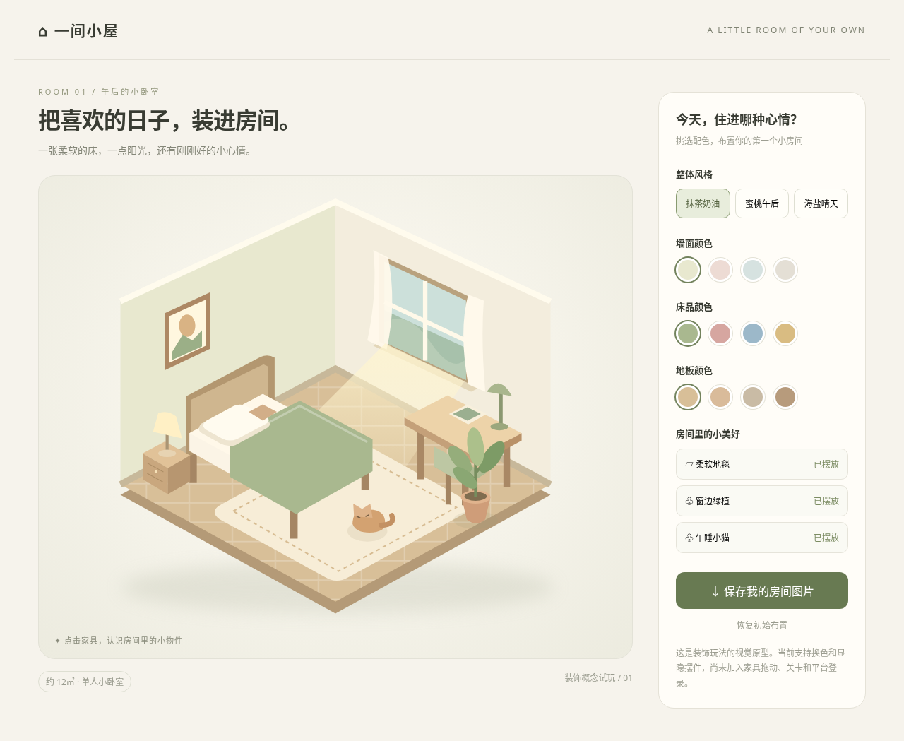

# 一间小屋 · 房间装饰小游戏原型

一个温馨小卧室的装饰玩法原型。使用原生 HTML、CSS、JavaScript 和内置 SVG，无需安装依赖，无外部网络请求。

## 目录

```text
cozy-room/
├── cozy-room-demo.zip       # 本次交付的原始 ZIP 试玩包
├── build/
│   └── index.html           # 可直接打开的网页，也是当前可编辑实现
├── previews/
│   ├── preview.png         # 桌面完整界面
│   ├── room.png            # 默认房间效果
│   └── mobile-preview.png  # 手机窄屏完整界面
├── README.md               # 使用与包结构说明
├── DESIGN.md               # 玩法、视觉与功能范围
└── VALIDATION.md           # 已完成的验证及边界
```

## 试玩

直接用现代浏览器打开 `build/index.html`。也可在本目录执行：

```sh
python3 -m http.server 8000 --directory build
```

然后在本机浏览器访问 `http://localhost:8000`。

## ZIP 包

`cozy-room-demo.zip` 原样保存此前交付的包；解压后入口为 `cozy-room-demo/index.html`。包内还包含原始 README 和三张效果图。`build/index.html` 与 ZIP 中的网页内容一致。

这是无需编译的静态网页，`build/` 是可运行文件目录。当前 ZIP 是网页试玩交付包，尚未接入小红书或 TapTap 平台 SDK，不能视为可直接上架的安装包。

## 维护与重新打包

修改 `build/index.html` 后，重新验证功能并更新效果图，再在本目录运行下面的命令，保留当前 ZIP 的内部目录结构：

```sh
python3 - <<'PYTHON'
from pathlib import Path
from zipfile import ZipFile, ZIP_DEFLATED
with ZipFile('cozy-room-demo.zip', 'w', ZIP_DEFLATED) as package:
    package.write('build/index.html', 'cozy-room-demo/index.html')
    package.write('README.md', 'cozy-room-demo/README.md')
    for image in sorted(Path('previews').glob('*.png')):
        package.write(image, 'cozy-room-demo/' + image.name)
PYTHON
python3 -m zipfile -t cozy-room-demo.zip
```


