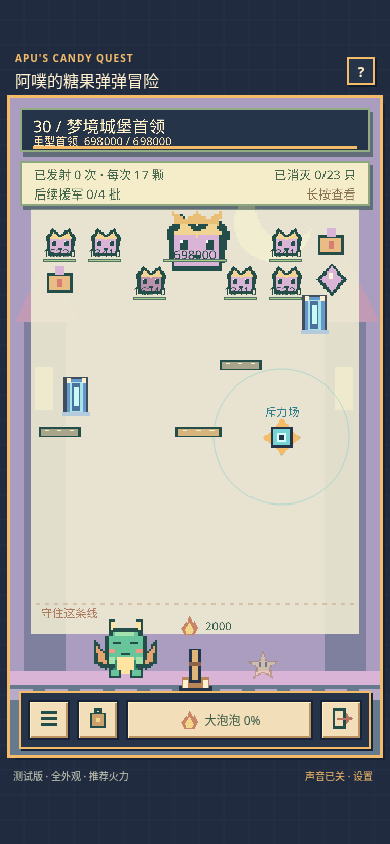
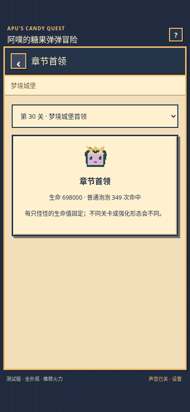
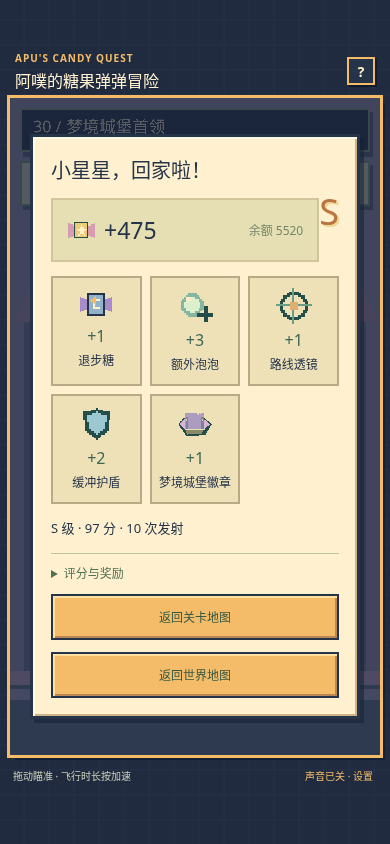

# 0.10.0：按升级预算校准怪怪与 Boss 生命

## 为什么这次分段调整

0.9 的炮台扩展至 Lv.99／2000 伤害，但敌人仍按旧 50 级曲线生成生命。后几章普通怪所需命中次数反而下降，末关首领只有 436240 生命。此次按关卡升级门槛和正常星糖预算分段提高生命，保留升级后重玩旧关更轻松的成长收益。

怪怪生命只取决于固定关卡、类型和耐久单位；不读取玩家当局火力、余额、表现或广告情况，不会因玩家升级再动态追着加血。已过关进度、库存和外观继续保留，星糖奖励与升级价格不变。

## 章节数值

下表火力是进入章末 Boss 前、正常完成前置并购买升级的普通伤害；章末过关才解锁的档位未提前计算。命中数是整章普通怪／精英的中位数，未计暴击、冰壳、穿透和连锁。

| 主题 | Boss 战前火力 | 旧 Boss 生命 | 新 Boss 生命 | 增幅 | 普通怪／精英典型命中 |
| --- | ---: | ---: | ---: | ---: | ---: |
| 糖果森林 | 140 | 12600 | 13700 | +8.73% | 3 / 3 |
| 泡泡海湾 | 190 | 20900 | 22600 | +8.13% | 4 / 4 |
| 冰晶雪原 | 248 | 34720 | 37500 | +8.01% | 5 / 5 |
| 蘑菇秘境 | 316 | 75840 | 80400 | +6.01% | 6 / 6 |
| 齿轮工厂 | 394 | 86680 | 91900 | +6.02% | 7 / 8 |
| 沙漠遗迹 | 482 | 130140 | 138000 | +6.04% | 7 / 8 |
| 星光天文台 | 732 | 160920 | 178000 | +10.61% | 8 / 9 |
| 霓虹都市 | 1173 | 234240 | 300000 | +28.07% | 8 / 9 |
| 云端群岛 | 1541 | 417360 | 564000 | +35.14% | 9 / 10 |
| 梦境城堡 | 2000 | 436240 | 698000 | +60% | 10 / 11 |

前六章普通怪较旧版增加约 5%—15%，精英约 12%—20%；第七章普通怪约 10%—31%；后三章普通怪约 28%—81%，精英约 35%—92%。这是同一章各固定关卡的差异，不是怪物生命随机区间；每只怪的生命仍是固定值。

前中期 Boss 原本已接近推进压力线，增幅保持 6%—9%；后三章分别约 28%、35%、60%。末关为 698000（约 70 万），没有直接恢复成随 2000 火力同比生成的 820000。

## 公式和道具边界

普通怪生命为旧固定生命乘以 `max(1,本关可负担火力/旧生命基准火力)^0.70 × (1.05 + 主题序号×0.008 + 小关序号/29×0.035)`，精英额外乘 1.06，向上取整到十位。序号从零开始。0.70 的指数只补偿一部分升级加速，保留升级收益。

章节 Boss 使用固定倍率 `[1.08,1.08,1.08,1.06,1.06,1.06,1.10,1.28,1.35,1.60]`，生命不足十万的向上取整到百位，其余到千位。秘境 Boss 只获得所在章增幅的 75%，仍受章末 Boss 生命 35%／45%／60% 的对应上限约束。

爆炸物、拾取物生命和连锁伤害不变，保持可用的引爆入口。分裂小守卫采用同关普通怪规则；时光回退精确还原快照生命，不重复套倍率。图鉴与场内生成使用同一个 `enemyHealth` 方法。

## 星糖和测试

模型逐关模拟 C、A、S 奖励与升级开销。只拿 C 级首通和基础任务／宝箱，仍可在最终关前到 Lv.99，并剩 5045 星糖；另一个模型将每次到账约 20% 用于其他消费，所有关卡仍跟得上同样升级档位。这不是保证任意消费方式都能立即满级。

实际 300/300 主线与 30/30 秘境模拟通关，成功路线未使用库存道具。额外从正式 ZIP 加载全 C 收入的正常存档验证末关：2000 伤害、698000 Boss、剩余 5045 星糖进入，未消耗道具。成功角度方案在第 3 次发射击败 Boss，第 10 次完成整关（含援军与守卫）；不把整关发射次数误称为 Boss 存活次数。

自动策略会重试角度，数据证明存在通关路线，不代表真人首次成功率。首次试玩后仍可按玩家失败位置和通关时间进一步微调。

正式版和全解锁测试版各 199 文件、唯一根入口。测试版继续开放所有外观、装备、主线及秘境，可固定任意火力；降低／提高测试火力不会改变同关怪物生命。

