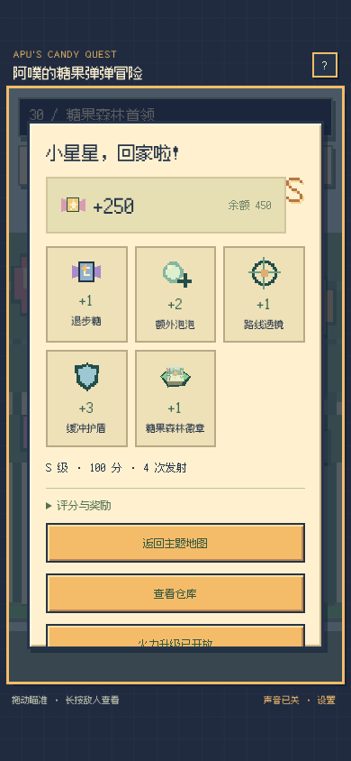
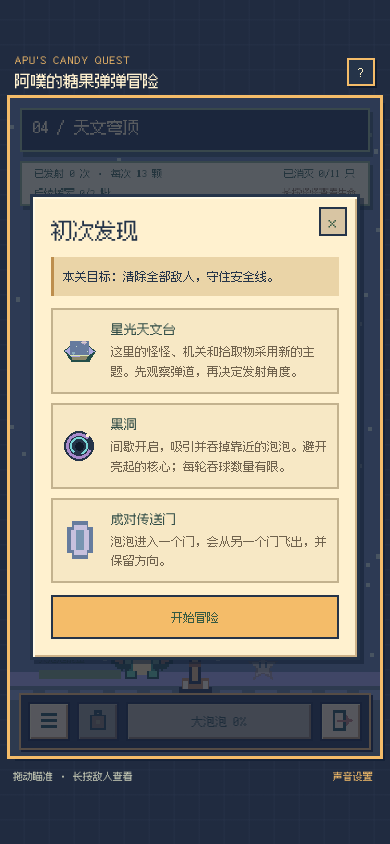

# 0.7.0：图标奖励、推进压力与首次发现

## 结算与道具

结算先显示统一星糖图标和实际总到账，再显示道具与主题徽章的图片、名称、数量。任务、首通、S 级和彩蛋给的同类道具合并；仓库到达上限时只显示实际增加的数量。详细评分规则可以展开，默认不再堆叠奖励描述文字。

| 道具 | 作用与获取 |
| --- | --- |
| 退步糖（新增普通） | 敌阵最多退回一步，保留已造成伤害；每局一次。第三关首通赠送、每六关首通补给，或仓库兑换 80 星糖。旧玩家按条件一次性补送。 |
| 时光回退（原有稀有） | 恢复上次发射前的局面；不退已用道具，不回拨限时。仍由秘境首通获得。 |

两者都在战斗内道具袋使用，不需要跳转仓库。退步糖需要先发射，再在两次发射之间使用；不会在已失败后复活。

## 六种新机关

| 机关 | 实际效果 | 主线首次出现（秘境可能更早） |
| --- | --- | --- |
| 黏液墙 | 反弹后速度降到 65%，约 0.9 秒后恢复；伤害不变 | 糖果森林第 9 关 |
| 弹射板 | 反弹后短暂提速到 480，约 0.75 秒后恢复；没有增加手动加速按钮 | 泡泡海湾第 6 关 |
| 分光棱镜 | 普通泡泡分出一颗半伤害泡泡；每颗只分光一次，每轮最多三颗；大泡泡不再分光 | 冰晶雪原第 9 关 |
| 横推带 | 局部水平推力，箭头与推力方向一致，不充当实心墙 | 齿轮工厂第 9 关 |
| 黑洞 | 3.2 秒周期内约 1.4 秒开启，吸引范围内泡泡，核心吞球；普通关每轮最多三颗，秘境五颗，达到数量后本轮熄灭 | 星光天文台第 4 关 |
| 电磁斥力场 | 周期性向外推开泡泡，不吞球；属于力场区域，不是实心挡板 | 霓虹都市第 6 关 |

原有石墙、脆冰、弹跳台、移动挡板、镜柱、相位屏障和成对传送门保留。普通关按主题逐步引入，后期和秘境组合使用；单个障碍仍保留两侧通道。黏液/弹射改变速度、棱镜改变球数、横推带/斥力改变轨迹、黑洞消耗泡泡，不靠换贴图冒充新玩法。

## 首次遇见说明

系统按当前关卡实际内容及玩家已经确认的记录判断，不硬编码“第 N 关必须弹”。如果先在秘境遇见某机关，回主线不会再次介绍。

首次的怪怪、精英、首领、主题、爆炸连锁、拾取物、大泡泡、新机关、风场、冰壳、传送门、挑战规则、首次获得的道具和功能装备，都使用图标＋短说明。图文放在开局前的弹框，游戏、物理与限时计时暂停，确认“开始冒险”后才继续；点返回地图不记为已读。

记录保存在正常/测试各自的本地存档。旧版本已完成的关卡可以迁移旧机关和已知玩法；本次新增加的机关不会因为旧存档完成过同一关而被误判为已看过。新推进规则下的首领会介绍一次。没有新内容时只保留简洁的本关目标。

## 声音修复及范围

确认并修复了前后台事件错误地清除声音解锁标记和音乐主题的问题。回前台现在续播同一主题；音乐源意外结束会重建，音效节点若缺失结束回调会按生命周期清理，音频上下文关闭后可在下一次触摸重建。总开关、暂停和系统的浏览器播放限制仍会被尊重。

已完成六分钟实际 Web Audio 持续播放与多次输出采样，期间测试前后台、挂起恢复、音乐源丢失；另从上传包验证丢失 24 个音效结束事件的清理、关闭上下文后重建及静音。测试环境为桌面 Chromium，不能代替 iPhone 小红书宿主和硬件听感复测。

## 上传包

所有新机关与退步糖的图标合并为一张 7 格像素图。两份 ZIP 均为 199 个文件、一个根入口，保留 72 款可购买外观及 3 款免费外观；继续受 200 文件硬上限检查。测试版仍全关开放且自动配至少推荐火力，普通版保持解锁和升级门槛。

