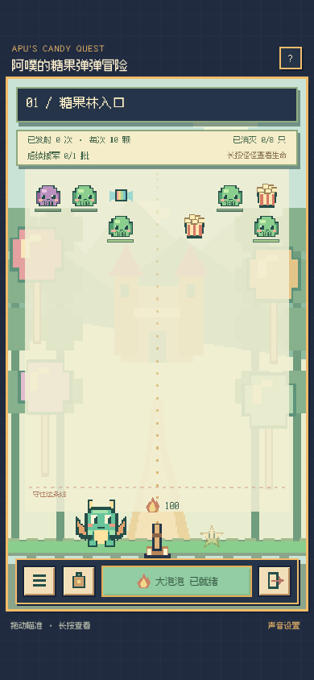
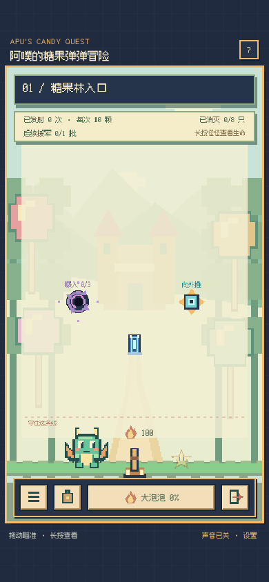
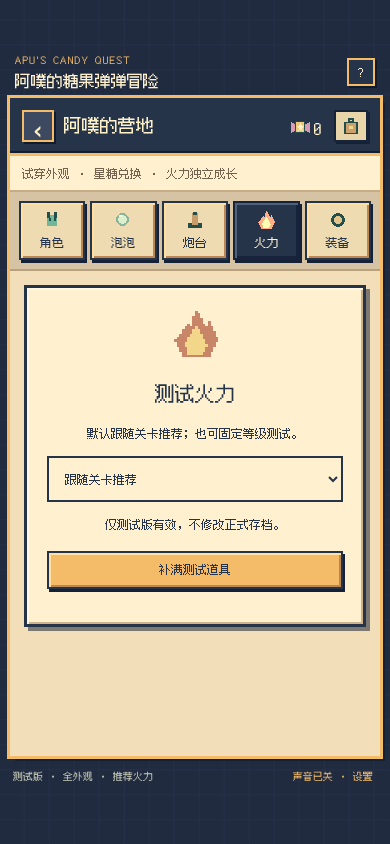

# 0.8.0：单一能量入口、清晰机关与测试解锁

## 战斗能量

移除阿噗旁的“大泡泡能量”标题与独立条，仅保留底部大泡泡按钮。按钮使用泡泡图标、百分比及从左到右的像素填色，满能量显示“释放大泡泡”，装填后改成绿色。命中怪怪加 5 能量，100 点发动首颗四倍伤害；这次没有改变充能或伤害规则。阿噗稍向左调整，与炮台及伤害数字分开。

## 黑洞、斥力场和传送门

| 机关 | 轮廓 | 功能和反馈 |
| --- | --- | --- |
| 黑洞 | 紫色旋涡、黑色核心，粒子向内收拢 | 活跃时拉近泡泡，进入核心才吞；显示“吸入 0/3”“休眠”或“本轮已满”。秘境上限 5 颗。吞噬有缩入核心的动画。 |
| 电磁斥力场 | 青色方形磁芯、金色向外箭头 | 向外推开泡泡，不吞球；显示“向外推”或“休眠”，粒子向外扩散。 |
| 成对传送门 | 蓝色矩形门框 | 从另一扇门穿出、保留飞行方向，不吞球。 |

黑洞和斥力场沿用每 3.2 秒中前 1.4 秒激活的设定。吞噬满额后本轮不再吸或吞，下次发射重置额度。此次实际连续飞行验证了中心吞球、休眠穿过、3 颗上限和斥力方向，没有把“能吸引”当成“已吞掉”。

战斗中长按机关 450 毫秒可查看图标、用途和当前状态，说明期间暂停；移动瞄准会取消长按。此前只有怪怪支持长按。瞄准线也不再把黑洞、斥力场和横推带等非实体区域标成挡板；相位屏障只在实体状态阻挡预览。引力改变后的弯曲轨迹仍需玩家判断。

## 入口与返回

- 世界地图：保留“营地”“图鉴”；左上返回主菜单。
- 章节路线：保留“战前准备”“章节任务”；左上返回世界地图。战前准备打开营地，完成准备可直接返回原章节。
- 营地：保留角色、泡泡、炮台、火力、装备分类；标题右侧背包图标进入仓库，返回时回到原营地分类，再返回原入口。
- 仓库：保留已拥有的道具、外观、装备和收藏，战斗仍使用原快捷道具袋。
- 战斗：保留暂停菜单里的敌人图鉴，便于当场查看固定生命；没有增加章内重复图鉴入口。
- 通关：普通关显示“前往下一关”和“返回关卡地图”；章节最终首领显示“前往下一主题”和“返回关卡地图”；全主线终点与秘境显示“返回关卡地图”和“返回世界地图”。原图标奖励、评分详情与符合条件的火力升级提示继续保留。

## 全解锁测试版

请使用 `dragon-bubbles-0.8.0-test.zip`。测试模式开放所有 10 世界、300 主线、30 秘境；75 款外观（72 付费款＋3 基础款）、3 件功能装备全部标记为已拥有，可免费装备。保留已有装扮选择。

营地“火力升级”在测试版提供 52 个选项：推荐火力与 Lv.0—50，分别可测试 100 基础伤害、1100 最高伤害及中间档；默认推荐并不把实际升级等级永久写满，切回低关也跟随该关推荐值。自选等级可持久保存。

首次使用本测试版本，每类消耗道具至少补到 10 个；正常使用会扣除，重载不补回，需在测试火力页点击“补满测试道具”补到 20 个。已有超过 20 个时该按钮也会设为 20 个。

测试版单独使用 `apu-candy-playtest-v1`；普通版 `apu-candy-v1` 保持正常购买、解锁与升级。实际在同一来源验证测试游玩、装备切换、补道具、选择火力及重载均不改变普通版存档。宣传片仍待正式素材配置，测试版开放秘境不代表接入广告。

## 交付与验收

两包各 199 个文件，唯一 HTML 为根目录 `index.html`；复用现有机关图集与传送门图片，没有新增运行时文件。主线与秘境生命数据、奖励与推进速度保持 0.7 数值。

当前双包验收覆盖实际 Phaser 飞行、能量消费、真实首关胜利结算、各类结算返回、菜单上下文、全部外观价档、装备切换、测试火力上下限和重载、道具补给、正式存档隔离、320/390/430 宽度及浏览器运行错误。详见 [验证记录](VALIDATION.md)。

