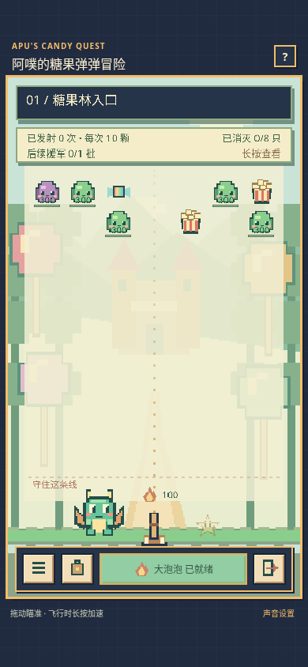
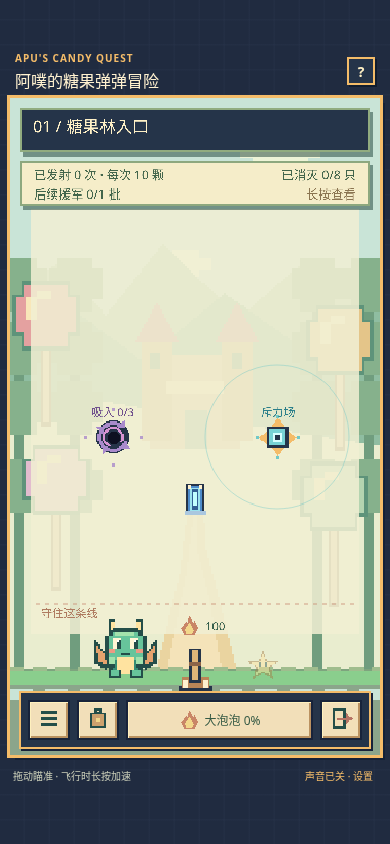
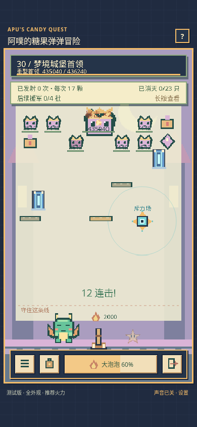
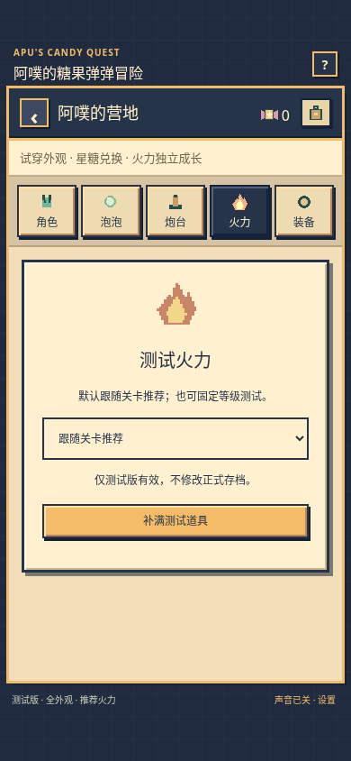

# 0.9.0：长按加速、暴击、99 级成长和清晰文字

- 飞行时长按战场 220 毫秒，两倍加速；出现“加速 ×2 · 松手恢复”提示。短点不加速，松手和暂停恢复。加速也作用于限时倒计时，不作为隐藏的时间优势。
- 同一轮对同一怪怪每第 10 次有效泡泡命中双倍暴击，有浮字、闪光和独立声音；每轮、每怪分别计数，冰壳与爆炸不计。
- 炮台延长到 Lv.99，最高 2000。Lv.50 仍为 1100，旧购买等级保留；最高档在第 295 关通关后开放，防止最终关挡住升级门槛。前六章成长保持，后四章逐步加密升级。
- 取消每局／每轮道具次数上限，仍消耗自己的库存，在两次发射间使用。额外泡泡、瞄准距离、护盾和星爆准备可叠加；退步糖可重复后退，时光回退可逐个撤回历史发射。无有效目标不扣道具。
- 全部界面文字改用系统无衬线字体，场内画布文字以四倍分辨率渲染；发射计数、援军和目标至少 12px。场景、人物、图标、边框继续使用像素风。包里保留原字体及许可供历史素材使用，没有新增线上字体依赖。
- “向外推”改成“斥力场”，显示生效范围和向外脉冲，长按查看说明；激活时泡泡进入范围便向外偏转一次，保持速度大小。和紫色吞球黑洞、蓝色传送门继续保持明显区分。

## 测试版

`dragon-bubbles-0.9.0-test.zip` 延续全关、全部外观与装备开放。营地“火力升级”提供推荐火力或 Lv.0—99（100—2000）选择，以及“补满测试道具”按钮。沿用独立测试存档；原测试库存不会在重载后反复恢复，缺道具时可手动补到 20 个。普通版保持正常星糖购买和通关门槛。

## 保持固定生命

修正旧程序“推荐火力同时用于生成怪怪生命”的耦合，把怪物生命计算独立冻结在原曲线，图鉴使用同一公式。最后一关 Boss 生命仍为 436240，新的玩家伤害最高 2000。不能通过同步加厚 Boss 来抵消这次成长提升。

检查长时间等待时还发现云端群岛弹射板与石墙之间存在狭窄角隙，泡泡会重复碰撞；现将该章弹射板移开。这项布局修复不更改敌人生命、波次或奖励。

## 验证范围

实际两份上传包验证长按/短点、两倍飞行距离、松手/暂停/结算恢复、暴击第 10 次、护甲与连锁排除、叠加库存扣除、重复退步、连续回退、不返还倒计时与道具、旧存档及正式/测试隔离。300 主线和 30 秘境物理模拟均通关，成功路线未用库存；自动角度策略会重试，不能代表真人成功率。

上传包仍各 199 文件，只有根目录 index.html 一个 HTML。未代上传小红书，iPhone 宿主的触摸、字体和音频仍需真机体验。

