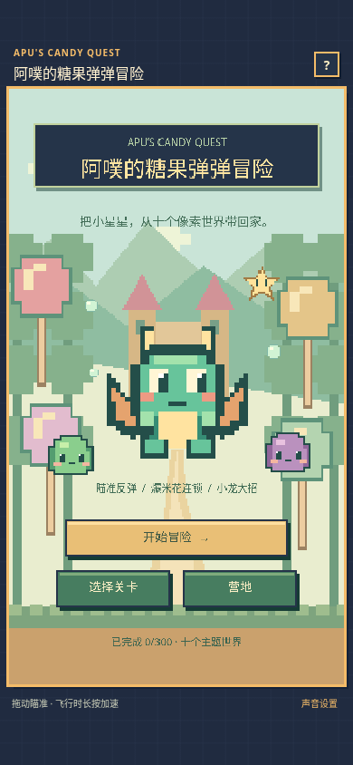

# 阿噗的糖果弹弹冒险 · 1.0.2 用户同步版

当前基准为 2026-11-25 用户提供的 `1.0.2-xhs-secret-prompt` 包，已接入本地 QuantDash 推广短片和通关后的秘境入口提醒。玩法和数值沿用 0.10.0 定稿。

**[下载用户提供的最新 ZIP](https://raw.githubusercontent.com/cxq24/xiaohongshu-tools/main/dragon-bubbles/dragon-bubbles-1.0.2-xhs-secret-prompt.zip)**

当前上下文、与旧包的差异和维护边界见 [CURRENT_PACKAGE.md](CURRENT_PACKAGE.md)。原包和解包运行代码均原样保存，本次未另发 1.0.3。

## 上传

1. 下载 ZIP，直接上传小红书部署页面。
2. 版本号填写 `1.0.2`。
3. 本游戏无需相机、麦克风或定位权限。

最新包内 **196 个文件**，只有一个根目录 `index.html`，不含 Markdown 或构建依赖；内含已配置的推广画面与音轨。不要重新压缩整个仓库或旧 `build/` 目录。详细信息见 [生产说明](PRODUCTION_RELEASE.md)。

## 游戏内容

- 10 个主题世界、300 个主线关卡，世界图与章内路线双层选择。
- 拖动瞄准、反弹连锁、大泡泡；飞行时长按两倍加速。
- 同轮对同一怪怪每第 10 次有效泡泡命中双倍暴击。
- 炮台 Lv.99／2000 伤害，末关 Boss 698000 生命；关卡生命固定。
- 库存道具可叠加，战斗内使用；正常通关与星糖消费解锁成长。
- 角色、泡泡、炮台共 75 款外观；外观与伤害分离。
- 图鉴、仓库、评分奖励、音量设置、退出确认与本地进度保存。

正式包已剔除全解锁、测试火力和测试库存逻辑，并精简帮助及页面说明。1.0.2 修复扫码预览启动时的缓存兼容问题，自动检测存储能力，不要求用户提供客户端版本。支持原生本地缓存及可读取的旧存档迁移；真实读取失败保留原档，可重试或选择不保存进度的试玩。不要清理缓存，详见 [原生缓存说明](NATIVE_STORAGE.md)。

## 秘境视频

每章第 5、15、25 小关是秘境触发点。通关对应小关后，结算页出现“秘境入口出现了！”提醒，可选择进入秘境或继续下一关；以后也可从章节地图进入。完整观看 30 秒后，只解锁本次对应的秘境；已解锁秘境可直接重试。

当前短片已采用本地 Canvas 图集与 Web Audio 音轨方案：360×640、10 fps、300 帧，75 张 WebP 图集、14 个音轨脚本。加载等待、暂停、切后台、退出确认期间不累计观看时间；退出需确认。它是自有产品宣传，不是平台商业广告 SDK，不产生平台广告分成。

## 开发与验证

**当前可运行代码**位于 [releases/1.0.2-xhs-secret-prompt/runtime/](releases/1.0.2-xhs-secret-prompt/runtime/)，逐文件与用户 ZIP 一致。旧 `build/` 是此前 1.0.2 的分模块开发源文件，尚未回合本次外部改动，不能用旧打包器重建并冒充最新包。维护和验收方法见 [开发说明](DEVELOPMENT.md)，数值规则见 [BALANCE.md](BALANCE.md)，验证记录见 [VALIDATION.md](VALIDATION.md)。

Phaser MIT 与所保留字体的完整许可见 `PHASER-LICENSE.txt`、`FONT-LICENSE.txt`，也保留在生产入口注释中。

