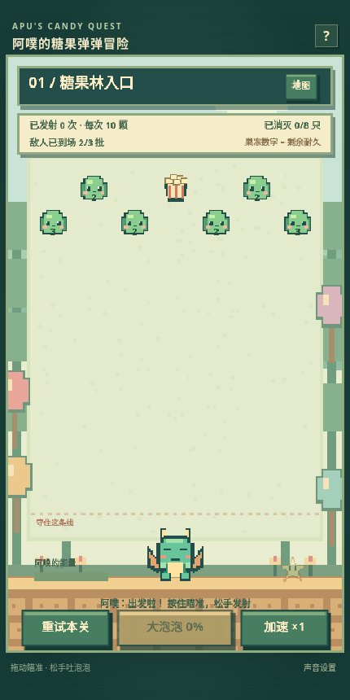
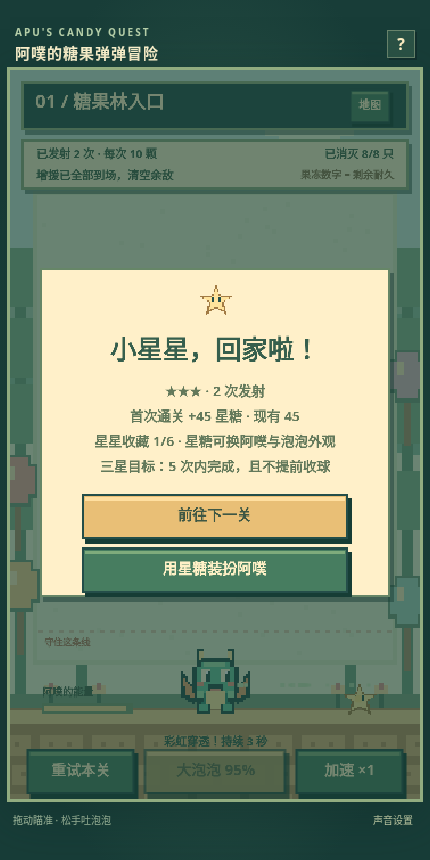
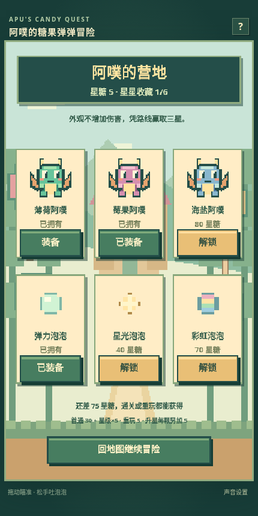

# 阿噗的糖果弹弹冒险

以像素小龙、糖果森林和果冻怪为主题的回合制弹球清屏小游戏，基于 Phaser 3.90.0。先阅读开源引擎和弹球示例，再开发自己的角色、美术与六关玩法，调研依据见 [RESEARCH.md](RESEARCH.md)。

## 下载与试玩

[下载 0.2.0 ZIP](https://raw.githubusercontent.com/cxq24/xiaohongshu-tools/main/dragon-bubbles/dragon-bubbles-0.2.0.zip)

ZIP 根目录是 `index.html`，只包含网页运行文件；完整引擎许可证放在入口 HTML 注释中，不包含 Markdown、开发工具或预览图。运行时无外部服务或 CDN 依赖。

本地试玩需通过 HTTP 提供页面（Phaser 的图片加载器需要正常网页来源）：

```sh
# 在 dragon-bubbles 目录
python3 -m http.server 8000 --directory build
```

然后用本机浏览器访问 `http://localhost:8000`。解压 ZIP 后也可以在解压目录运行 `python3 -m http.server 8000`。不要直接双击 HTML，以免文件协议下的图片加载受到浏览器限制。

## 0.1.1 上传包修复

小红书提示只能包含一个 HTML 文件，旧版附带的 `vendor/LICENSE.html` 会导致部署失败。新版删除第二个 HTML，将完整 MIT 许可证保留在 `index.html` 注释中，打包脚本强制检查整个包仅有根目录 `index.html`。玩法和引擎代码没有修改。该修复持续保留在当前 0.2.0 包中，请使用顶部的最新下载。

## 0.2.0：声音、目标说明与通关奖励

- 原创循环像素背景乐；普通连发、大泡泡、不同果冻受击、消失、爆米花和角色拟声分别制作。音量可独立调节，阿噗使用卡通“啵、噗、呜呼”拟声与中文字幕，不使用真人或普通话 TTS 配音。
- 首次实际点击后启用声音，符合浏览器手势要求；可完全关闭。打开帮助或声音设置暂停战斗，切到后台也会停止播放。
- “已发射 X 次”与“敌人到场批数”分别显示，批数不是发射上限；增援结束后显示“增援已全部到场，清空余敌”。
- 开局明确目标为清除全部果冻；数字为每只果冻的耐久，不是固定命中目标。显示“已消灭 X/Y 只”，果冻王分裂的两只小果冻也预先计入总数。
- 首次通关得 `30 + 星级×5` 星糖；重玩得 `5`，高于历史最佳每颗星另加 `5`。结算后可直接前往营地。
- 营地可购买和装备阿噗外观及泡泡皮肤，不改变伤害。六关星星收藏进度与最佳星级同时保留。
- 旧存档自动保留关卡进度，并一次性补发已通关关卡的首通星糖；不会在刷新时重复补发。

## 操作

- 开始冒险后，在棋盘内按住并拖动，松手发射；可以从阿噗的位置向上拖动。
- 瞄准线显示首次目标接触前的预测路径，不预测命中后的所有反弹。
- 方向键左右调整角度，空格发射；地图和弹窗按钮用鼠标或触摸操作。
- 爆米花桶引爆邻近目标，彩虹糖让当前轮泡泡短暂穿透。
- 命中果冻积能，满能量后点击“大泡泡”，再瞄准发射。可以再次点击取消选择。
- 两倍加速缩短等待；提前收球会放弃剩余命中，并让敌人推进一轮。
- 共六关，过关后逐关解锁。波次全部出现且果冻清空后获胜，果冻越过虚线则失败，可以立即重试。
- 最高星级、解锁进度、星糖及已购买的外观保存在当前浏览器 localStorage；不保存当前局面、不跨设备同步。存储不可用时仍可游玩，但进度可能丢失。
- 声音默认在首次点击后启用，可在底部声音设置分别控制音乐、音效、角色拟声。帮助和声音设置打开时暂停战斗。

## 维护

- `build/`：可部署的运行文件；引擎固定版本保存在 `vendor/`。
- `tools/create_art.py`：原创像素图和角色帧的生成源，需要 Pillow。
- `tools/vendor-provenance.json`：引擎来源及 SHA 校验记录。
- `tools/browser_checks.py`：真实浏览器输入、碰撞和自动瞄准通关检查，需要 Playwright。
- `tools/test_progress.cjs`：星糖奖励、存档迁移、购买与升星的逻辑检查，需要 Node.js。
- `tools/feature_checks.py`：音频生成与播放、目标计数、奖励和营地的浏览器集成检查。
- `tools/package.py`：校验引擎 SHA-256、运行文件后缀和 ZIP 内容后生成交付包。
- `previews/`：实际浏览器截图，保留在仓库，不进入上传包。
- `DESIGN.md`、`RESEARCH.md`、`VALIDATION.md`：设计、选型和验证证据。

```sh
python3 tools/create_art.py
node tools/test_progress.cjs
python3 tools/package.py
python3 tools/browser_checks.py --archive
python3 tools/feature_checks.py
```

开发验证工具依赖可通过 `python3 -m pip install pillow playwright` 安装，再按 Playwright 说明安装 Chromium。云环境已提供 `/usr/bin/chromium`，测试脚本优先使用它。

## 当前限制

这是可玩的浏览器章节原型，尚未接入小红书或 TapTap SDK。依照此前部署截图的扩展名白名单打包，但官方小红书 skill 地址受到联网策略限制，未完成完整规范核验。尚未验证小红书宿主部署、真实手机兼容性、宿主音频和存档持久化，本次调整依据用户试玩反馈，更新后仍需用户真机试听、难度和留存验证；未做商业化系统。

Phaser 使用 MIT 许可，完整许可证保留在 [PHASER-LICENSE.txt](PHASER-LICENSE.txt) 和包内 `index.html` 的完整注释中。未使用官方示例中的第三方游戏图片。






