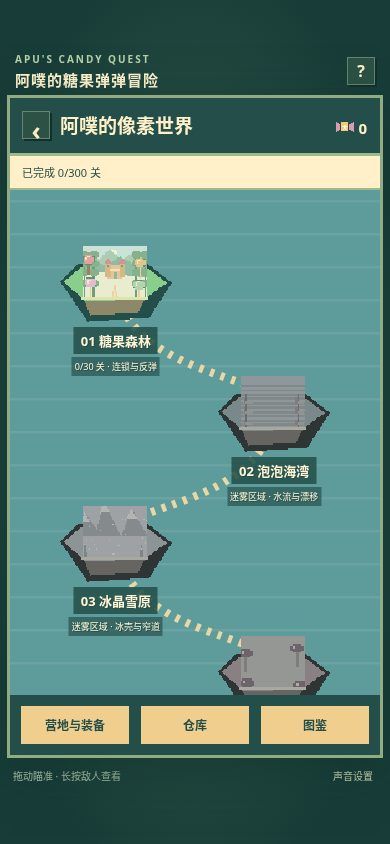
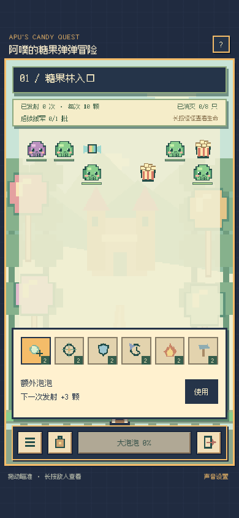
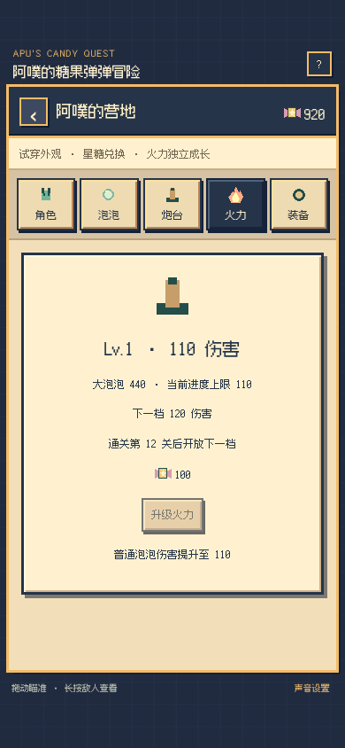
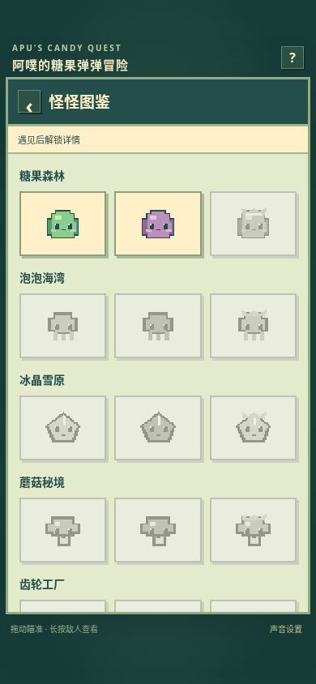
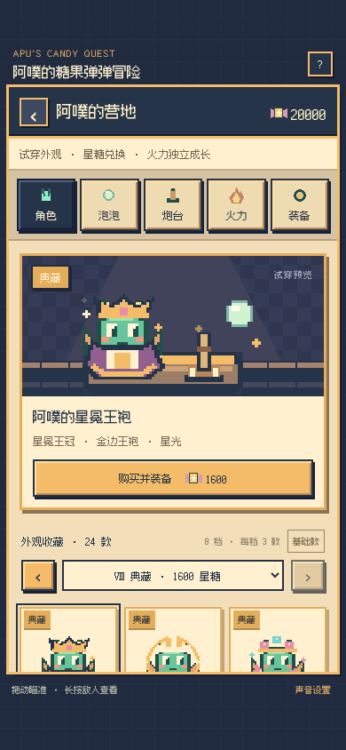
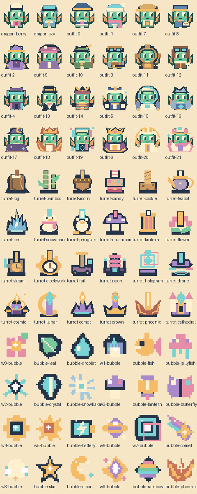
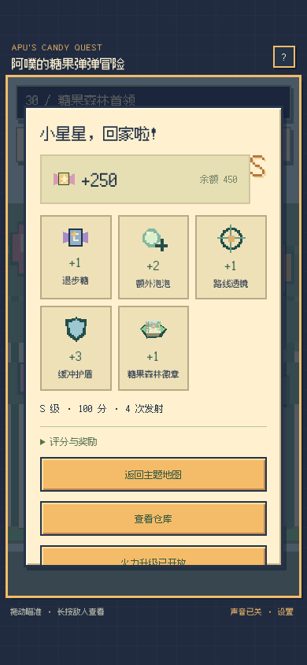

# 阿噗的像素弹弹冒险 · 0.7.0

Phaser 3.90.0 像素风弹球闯关游戏。本版包含 **10 个主题 × 30 个主线关卡，共 300 关，另有 30 个隐藏挑战**，保留双层地图，加入战斗内快捷道具栏、退出确认、图鉴、分类营地与进度限制的炮台成长。

[下载普通版 ZIP](https://raw.githubusercontent.com/cxq24/xiaohongshu-tools/main/dragon-bubbles/dragon-bubbles-0.7.0.zip) · [下载全关开放测试版 ZIP](https://raw.githubusercontent.com/cxq24/xiaohongshu-tools/main/dragon-bubbles/dragon-bubbles-0.7.0-test.zip)

测试版直接开放 10 个世界、300 个主线和 30 个隐藏挑战，使用至少本关推荐火力；页脚有测试版标记，存档使用独立键 `apu-candy-playtest-v1`。普通版仍用 `apu-candy-v1` 并保留正常解锁、升级与视频门槛。请勿把测试版当正式版本发布。

十个章节最终首领生命保持 0.6.0 的数值（0.5.0 的十倍），本版首领每轮推进 24—40 像素；秘境守卫由同章最终首领设定生命上限。UI 使用本地中文像素字体、统一阶梯边框和小色板；角色、泡泡、炮台各有 24 款可购买外观（每类另保留 1 个免费基础款），八个价格档各三款。保留 S/A/B/C 评分、首次 S 随机普通道具、首领宝箱和收藏徽章。详细规则见 [评分与奖励](SCORE_RULES.md) 和 [数值设计](BALANCE.md)。

0.7.0 上传包为 **199 个文件**，仍满足 200 上限；新增六种机关及退步糖共用一张像素图。结算改为星糖、道具和徽章的图片卡片；首领生命不变，提高后期每轮推进；首次遇见的玩法在开局前用图文介绍，确认后写入存档。修复音频前后台恢复及音效资源清理，已通过六分钟 Web Audio 持续播放检查。详见 [0.7 玩法说明](GAMEPLAY_0.7.md)。

## 运行与上传

请上传 `tools/package.py` 生成的 ZIP，不要直接压缩 `build/`：开发目录保留分开的源码，上传包会自动合并。超过 200 个文件时打包会失败，不会覆盖上一份有效包。

ZIP 仅有根目录 `index.html` 一个 HTML，完整 Phaser MIT 许可保留在入口注释中。包内不含 Markdown、开发工具、测试视频或 MP4。

```sh
# 在 dragon-bubbles 目录
python3 -m http.server 8000 --directory build
```

本机访问 `http://localhost:8000`。解压 ZIP 后也可在解压目录运行 HTTP 服务。图片加载需要正常网页来源，不建议双击 HTML。

## 两层地图

外层像素世界图展示十个区域；进入区域后是沿弯曲路线滚动的 30 个关卡节点，有精英、首领与隐藏入口。已过关可重玩，下一关自动开放。

| 区域 | 全局关卡 | 主题与机制 |
| --- | --- | --- |
| 糖果森林 | 1–30 | 果冻、爆米花连锁、穿透糖 |
| 泡泡海湾 | 31–60 | 水母、珊瑚、侧向水流 |
| 冰晶雪原 | 61–90 | 冰晶敌人、冰壳、可击碎冰障碍 |
| 蘑菇秘境 | 91–120 | 蘑菇精、弹跳台 |
| 齿轮工厂 | 121–150 | 机械敌人、横向移动挡板 |
| 沙漠遗迹 | 151–180 | 沙团守卫、镜面反射柱 |
| 星光天文台 | 181–210 | 星云敌人、成对传送门 |
| 霓虹都市 | 211–240 | 数据胶团、周期性屏障 |
| 云端群岛 | 241–270 | 云团、风场 |
| 梦境城堡 | 271–300 | 综合机关和首领 |

每个主题有自己的战斗背景、封面、岛屿图标、敌人轮廓、爆炸机关、拾取物和泡泡外观。背景音乐采用同一原创旋律的主题节奏与调式变体。

通完一章后免费开启下一主题；也可高价提前开启相邻主题，价格保持高价固定设置（首个付费主题 3400 星糖）。提前购买后可立即玩该章第一关，章内仍逐关解锁。所有消费都使用唯一货币 **星糖**。

## 战斗和奖励

- 拖动瞄准，松手发射一串泡泡；方向键调整角度，空格发射。
- 敌人数字代表剩余生命，◇ 表示冰壳；机关不计入击杀目标。
- 已发射次数、消灭数和后续援军分别显示；援军从 0 开始，不含开场敌人。批数不是发射上限；清完全部敌人获胜，敌人越过虚线失败。
- 不提供加速或提前收球。极端循环轨迹会自然回落，不销毁剩余泡泡或提前推进敌人。
- 每次命中怪怪获得 5 点大泡泡能量，满 100 可选择首颗四倍伤害；能量不随时间恢复。炮台旁显示当前普通伤害，升级后随之更新。
- 通关按表现评分 S/A/B/C；首次星糖 `30 + 主题序号×5 + 评级加奖`。重玩 5，刷新等级补评级差额。首次 S 额外随机普通道具，章节最终首领首通另发宝箱和收藏徽章。
- 每三个主线首通关掉落普通道具；每章完成 5 关、获得 3 个三星、击败首领分别有一次性任务奖励。
- 达成连击条件的彩蛋给普通道具，不直接送皮肤。皮肤和永久装备只用星糖购买。
- 仓库可积累额外泡泡、路线透镜、缓冲护盾；隐藏关首通提供时光回退、星爆泡泡、障碍消除等稀有道具。
- 道具袋默认收起；点击展开图标，点选或长按查看用途，点击“使用”才扣数量，成功后自动收起。不会进入仓库页面，也不弹二次确认。
- 新增普通道具退步糖：敌阵最多退回一步、保留已造成伤害，每局一次；第三关首通赠送、每六关首通补给，也可在仓库用 80 星糖兑换。原有稀有时光回退仍恢复上次发射前的局面。
- 主菜单可暂停、查看图鉴、返回章节或退出本局。返回章节和退出本局均先确认；取消后恢复当前战斗。
- 道具只在两次发射之间使用。回退不返还已消耗道具，也不撤回已结算奖励或限时挑战的计时。
- 长按敌人查看精确生命和预计命中数；全地图图鉴先展示所有怪怪外观，未遇见的置灰且不可点，已遇见的可查看具体关卡的固定生命值。

## 隐藏关与用户自有宣传视频

用户选择使用自己的 MP4 宣传片，**不是平台付费激励广告，不产生广告收益**。每章在第 5、15、25 关通关后出现一个可选隐藏入口，跳过不影响主线。

完整观看一次视频后开启对应隐藏关，之后失败可免费重试；稀有首通奖励只领一次，重玩只得少量星糖，不重复掉落稀有道具。

**交付包中尚未配置用户宣传片，隐藏关入口明确显示“视频待配置”。**战斗、解锁和奖励流程已实现并通过测试素材验证，但不会用倒计时或假完成事件向真实用户开放隐藏奖励。

素材到位后，在 `build/video-config.js` 填入平台允许的 HTTPS 托管地址。当前小红书上传规则不允许将 MP4 直接打入 ZIP。正式素材至少 30 秒，必须完整播放；后台切换会暂停，快进不计作观看完成。只有本机开发调试允许 localhost HTTP。

`rewarded.js` 是视频完成结果的适配层。将来如接真实广告 SDK，必须由该 SDK 的完成结果驱动，不能把自有宣传片当成有广告收益的投放。

## 声音与存档

首次真实触摸、点击或按键启动声音。0.7 修正切后台清掉声音授权与主题的错误；回前台续播同一主题，异常结束的背景音乐会重建，超时未清理的音效节点会释放。在支持的 iPhone 上请求 `audioSession.type = playback`；监听音频状态、页面焦点与前后台恢复，避免只依赖某个按钮。声音设置只保留总开关和三个音量滑杆；不显示诊断和技术参数。打开声音设置暂停战斗但保留背景乐，方便试听音量。

不能保证未操作页面就自动出声，也不能覆盖系统音量为零。已用真实浏览器 AudioContext 的挂起/恢复验证触摸重新启动；**iPhone 小红书预览的物理设备听感仍需用户复测**。

保留旧版通关、星级、星糖和外观；0.5.0 统一重编了关卡布局及生命预算，修正前六关与后续关卡的难度断层。新增任务若已达成会一次性补发；旧玩家按已有里程碑补上起始火力。存档仅在当前浏览器，不跨设备同步，也不是服务器防作弊存档。

## 开发与验证

运行文件、原创素材源和证据都保留在本目录。Pillow 用于生成像素图，Playwright 用于浏览器测试，FFmpeg 仅用于临时生成测试视频，不进入上传包。

```sh
python3 tools/generate_campaign.py
python3 tools/generate_cosmetic_catalog.py
python3 tools/create_art.py
python3 tools/create_world_art.py
python3 tools/create_ui_art.py
python3 tools/create_cosmetic_art.py
python3 tools/create_mechanism_art.py
node tools/test_progress.cjs
python3 tools/package.py
python3 tools/package.py --test
python3 tools/test_package.py
node tools/test_v5.cjs
node tools/test_v6.cjs
node tools/test_v7.cjs
python3 tools/v6_browser_checks.py
python3 tools/v6_release_checks.py
python3 tools/v6_cosmetic_checks.py
python3 tools/v7_browser_checks.py
python3 tools/audio_recovery_checks.py
python3 tools/audio_endurance.py
python3 tools/simulate_campaign.py --end 300
python3 tools/simulate_campaign.py --hidden --end 30
```

300 关来自可复现的关卡设计规则，生成后冻结为固定数据，并非逐关手工绘制。关卡组合敌人分布、波次、机关位置及主题机制；结构签名为 300/300 不同。300 主线和 30 隐藏关均已由实际 Phaser 物理引擎模拟通关，按进度使用推荐火力，其中第 270 关的测试路线使用正常获得的额外泡泡与缓冲护盾；没有注入额外火力或稀有道具。详细范围、限制与证据见 [VALIDATION.md](VALIDATION.md)。

手机真机兼容性、小红书本版部署、宣传片托管是否被宿主允许、人类玩家难度与留存尚未验证。自动通关证明可完成，不代表人类体验已经调平。




## 营地外观与成长

营地分为角色装扮、泡泡皮肤、炮台外观、火力升级和功能装备。当前每类都有 24 款可购买外观和 1 款免费基础外观，共 75 款。八档价格为 40、80、160、260、420、650、1000、1600 星糖，每档同类三款。角色改变服装与配饰，炮台改变炮身轮廓，泡泡改变图形；炮台与泡泡使用四帧光效，高档增加星屑拖尾或光点。外观均不增加伤害。

火力初始 100，每章五档，共 50 档，最高 1100；第六章最高 500。升级消耗星糖，资格必须通过实际关卡里程碑开放，费用与生命计算见 [BALANCE.md](BALANCE.md)。

隐藏关现在有四种规则：限时清屏、保护三颗生命的工程师、机关试炼和首领讨伐。均为单人；没有实现多人联机。限时挑战在菜单、道具栏和设置打开时暂停。

星糖在余额、价格和奖励中使用统一的带星纹糖果图标；任务奖励采用图标展示，结算星糖包含本次完成任务的额外到账。







## 皮肤展示与素材来源

商店先按角色、泡泡、炮台分类，再用价位选择器切换八档；每档并排展示三款。点选只改变试穿预览，购买才扣星糖，已购买款不会因价格调整补扣。功能装备和火力升级仍独立。完整 72 款表与设计边界见 [STYLE_GUIDE.md](STYLE_GUIDE.md)。

所有角色装扮、泡泡和炮台图形为本项目原创程序像素绘制；中文使用 [Fusion Pixel Font](https://github.com/TakWolf/fusion-pixel-font) 2026.11.10 发布版，OFL-1.1 及其随包来源许可保留于 `FONT-LICENSE.txt` 和唯一入口 HTML 注释。字体也在 ZIP 内，不依赖线上字体。

用户提供的 Game UI Database、itch.io 像素 UI、Lospec 本轮均被环境代理拒绝（403），未直接浏览，也没有复制它们的付费素材。设计说明明确区分这些待参考站点与实际读取的开源字体资料。








