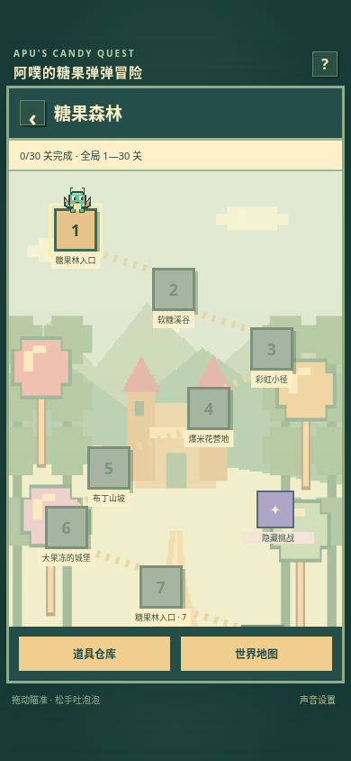

# 阿噗的像素弹弹冒险 · 0.3.0

Phaser 3.90.0 像素风弹球闯关游戏。本版包含 **10 个主题 × 30 个主线关卡，共 300 关，另有 30 个隐藏挑战**，同时加入双层地图、星糖解锁、仓库消耗道具与 iPhone 音频恢复处理。

[下载 0.3.0 ZIP](https://raw.githubusercontent.com/cxq24/xiaohongshu-tools/main/dragon-bubbles/dragon-bubbles-0.3.0.zip)

## 运行与上传

ZIP 仅有根目录 `index.html` 一个 HTML，完整 Phaser MIT 许可保留在入口注释中。包内不含 Markdown、开发工具、测试视频或 MP4。

```sh
# 在 dragon-bubbles 目录
python3 -m http.server 8000 --directory build
```

本机访问 `http://localhost:8000`。解压 ZIP 后也可在解压目录运行 HTTP 服务。图片加载需要正常网页来源，不建议双击 HTML。

## 两层地图

外层像素世界图展示十个区域；进入区域后是沿弯曲路线滚动的 30 个关卡节点，有精英、首领与隐藏入口。已过关可重玩，下一关自动开放。

| 区域 | 全局关卡 | 主题与机制 |
| --- | --- | --- |
| 糖果森林 | 1–30 | 果冻、爆米花连锁、穿透糖 |
| 泡泡海湾 | 31–60 | 水母、珊瑚、侧向水流 |
| 冰晶雪原 | 61–90 | 冰晶敌人、冰壳、可击碎冰障碍 |
| 蘑菇秘境 | 91–120 | 蘑菇精、弹跳台 |
| 齿轮工厂 | 121–150 | 机械敌人、横向移动挡板 |
| 沙漠遗迹 | 151–180 | 沙团守卫、镜面反射柱 |
| 星光天文台 | 181–210 | 星云敌人、成对传送门 |
| 霓虹都市 | 211–240 | 数据胶团、周期性屏障 |
| 云端群岛 | 241–270 | 云团、风场 |
| 梦境城堡 | 271–300 | 综合机关和首领 |

每个主题有自己的战斗背景、封面、岛屿图标、敌人轮廓、爆炸机关、拾取物和泡泡外观。背景音乐采用同一原创旋律的主题节奏与调式变体。

通完一章后免费开启下一主题；也可高价提前开启相邻主题，价格约为上一章三星首通基础收入的 2.5 倍。提前购买后可立即玩该章第一关，章内仍逐关解锁。所有消费都使用唯一货币 **星糖**。

## 战斗和奖励

- 拖动瞄准，松手发射一串泡泡；方向键调整角度，空格发射。
- 敌人数字代表耐久，◇ 表示冰壳；机关不计入击杀目标。
- 已发射次数、消灭数和到场批数分别显示。批数不是发射上限；清完全部敌人获胜，敌人越过虚线失败。
- 两倍加速缩短等待；收球会放弃剩余命中并结束本轮。
- 满能量可选择大泡泡；三星要求显示在结算页。
- 首通基础星糖：`30 + 星级×5 + 主题序号×5`；重玩 5，超过最高星级每颗额外 +5。
- 每三个主线首通关掉落普通道具；每章完成 5 关、获得 3 个三星、击败首领分别有一次性任务奖励。
- 达成连击条件的彩蛋给普通道具，不直接送皮肤。皮肤和永久装备只用星糖购买。
- 仓库可积累额外泡泡、路线透镜、缓冲护盾；隐藏关首通提供时光回退、星爆泡泡、障碍消除等稀有道具。
- 道具只在两次发射之间使用，成功使用才扣数量。回退不返还已经消耗的道具，也不能撤回已结算的关卡。

## 隐藏关与用户自有宣传视频

用户选择使用自己的 MP4 宣传片，**不是平台付费激励广告，不产生广告收益**。每章在第 5、15、25 关通关后出现一个可选隐藏入口，跳过不影响主线。

完整观看一次视频后开启对应隐藏关，之后失败可免费重试；稀有首通奖励只领一次，重玩只得少量星糖，不重复掉落稀有道具。

**交付包中尚未配置用户宣传片，隐藏关入口明确显示“视频待配置”。**战斗、解锁和奖励流程已实现并通过测试素材验证，但不会用倒计时或假完成事件向真实用户开放隐藏奖励。

素材到位后，在 `build/video-config.js` 填入平台允许的 HTTPS 托管地址。当前小红书上传规则不允许将 MP4 直接打入 ZIP。正式素材至少 30 秒，必须完整播放；后台切换会暂停，快进不计作观看完成。只有本机开发调试允许 localhost HTTP。

`rewarded.js` 是视频完成结果的适配层。将来如接真实广告 SDK，必须由该 SDK 的完成结果驱动，不能把自有宣传片当成有广告收益的投放。

## 声音与存档

首次真实触摸、点击或按键启动声音。在支持的 iPhone 上请求 `audioSession.type = playback`；监听音频状态、页面焦点与前后台恢复，避免只依赖某个按钮。设置页有重新启用按钮及折叠的声音诊断。

不能保证未操作页面就自动出声，也不能覆盖系统音量为零。已用真实浏览器 AudioContext 的挂起/恢复验证触摸重新启动；**iPhone 小红书预览的物理设备听感仍需用户复测**。

保留旧版关卡、星级、星糖和外观，原来的六关位置不变。新增任务若已达成会一次性补发。存档仅在当前浏览器，不跨设备同步，也不是服务器防作弊存档。

## 开发与验证

运行文件、原创素材源和证据都保留在本目录。Pillow 用于生成像素图，Playwright 用于浏览器测试，FFmpeg 仅用于临时生成测试视频，不进入上传包。

```sh
python3 tools/generate_campaign.py
python3 tools/create_art.py
python3 tools/create_world_art.py
node tools/test_progress.cjs
python3 tools/package.py
python3 tools/campaign_browser_checks.py
python3 tools/simulate_campaign.py --end 300
python3 tools/simulate_campaign.py --hidden --end 30
```

300 关来自可复现的关卡设计规则，生成后冻结为固定数据，并非逐关手工绘制。保留原六关，后续关卡组合敌人分布、波次、机关位置及主题机制；结构签名为 300/300 不同。300 主线和 30 隐藏关均已由实际 Phaser 物理引擎模拟通关，未使用仓库道具。详细范围、限制与证据见 [VALIDATION.md](VALIDATION.md)。

手机真机兼容性、小红书本版部署、宣传片托管是否被宿主允许、人类玩家难度与留存尚未验证。自动通关证明可完成，不代表人类体验已经调平。



