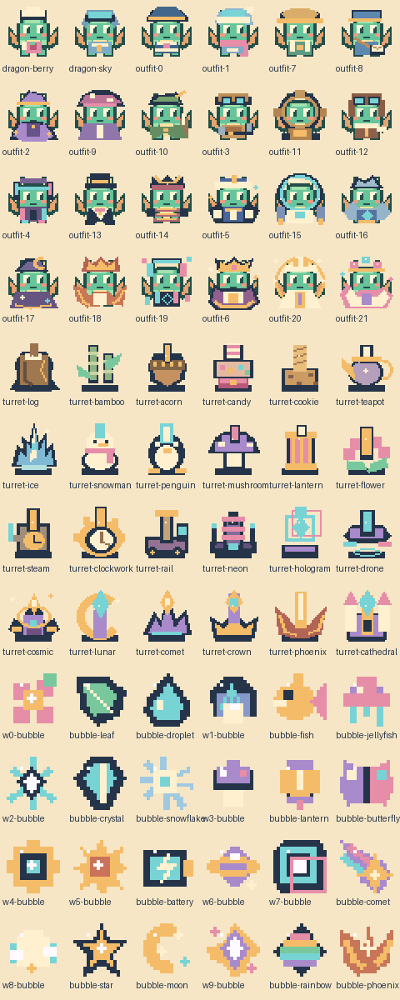
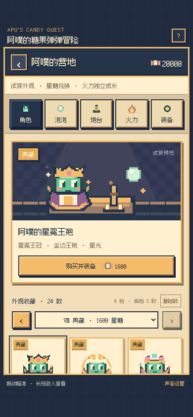

# 0.6.0 像素 UI 与 72 款外观设计

## 数量与价格

角色装扮、泡泡皮肤、炮台外观分别有 **24 款可购买设计**，每类八个价位、同价三款；共 72 款。每类另有一款免费基础外观，共 75 款外观。功能装备另算，不混入皮肤数量。

同价位三款是审美选择，保持相近制作量；不是同一图形换三种颜色。高价逐步增加服装/炮身结构、构图层次和实际战斗中的星屑或光点。外观不改变伤害、碰撞半径、球数或充能。

## 角色装扮

| 星糖 | 同价三款 |
| ---: | --- |
| 40 | 莓果阿噗 / 海盐阿噗 / 阿噗的航海服 |
| 80 | 阿噗的雪帽 / 阿噗的野餐背带装 / 阿噗的邮差制服 |
| 160 | 阿噗的学徒披风 / 阿噗的蘑菇斗篷 / 阿噗的林地游侠装 |
| 260 | 阿噗的工匠围裙 / 阿噗的深潜装 / 阿噗的飞行夹克 |
| 420 | 阿噗的霓虹外套 / 阿噗的庆典礼服 / 阿噗的糖甲武者装 |
| 650 | 阿噗的星轨领航服 / 阿噗的星际宇航服 / 阿噗的龙骑士铠甲 |
| 1000 | 阿噗的月影法袍 / 阿噗的焰羽战衣 / 阿噗的全息战衣 |
| 1600 | 阿噗的星冕王袍 / 阿噗的星砂祭司装 / 阿噗的梦境礼装 |

## 泡泡皮肤

| 星糖 | 同价三款 |
| ---: | --- |
| 40 | 糖果森林泡泡 / 新叶泡泡 / 晨露泡泡 |
| 80 | 泡泡海湾泡泡 / 河豚泡泡 / 水母泡泡 |
| 160 | 冰晶雪原泡泡 / 棱冰泡泡 / 霜花泡泡 |
| 260 | 蘑菇秘境泡泡 / 萤灯泡泡 / 幻蝶泡泡 |
| 420 | 齿轮工厂泡泡 / 沙漠遗迹泡泡 / 电池泡泡 |
| 650 | 星光天文台泡泡 / 霓虹都市泡泡 / 彗尾泡泡 |
| 1000 | 云端群岛泡泡 / 星光泡泡 / 弯月泡泡 |
| 1600 | 梦境城堡泡泡 / 彩虹泡泡 / 焰羽泡泡 |

## 炮台外观

| 星糖 | 同价三款 |
| ---: | --- |
| 40 | 树桩发射器 / 竹节发射器 / 松果发射器 |
| 80 | 糖果发射器 / 饼干发射器 / 茶壶发射器 |
| 160 | 冰晶发射器 / 雪人发射器 / 企鹅发射器 |
| 260 | 蘑菇发射器 / 灯笼发射器 / 花苞发射器 |
| 420 | 蒸汽发射器 / 钟表发射器 / 列车发射器 |
| 650 | 霓虹发射器 / 全息发射器 / 浮游发射器 |
| 1000 | 星云发射器 / 弯月发射器 / 彗星发射器 |
| 1600 | 王冠发射器 / 焰羽发射器 / 梦堡发射器 |

八个价位对应初旅、灵巧、精制、珍奇、华彩、史诗、星耀、典藏，基础免费款独立标识。

## 购买与成长

- 价位选择器有八档，每次展示同价的三款；可以直接试穿比较。试穿不改变装备、不扣星糖；购买后才扣并装备。
- 基础款入口始终可用，可随时切回。仓库保留已拥有的全部外观，重新装备不扣钱。
- 旧存档保留全部已有 ID、装备与库存，价格重编不补扣。高价角色与炮台仍有主题开放门槛，主题泡泡按对应地图开放。
- 高价皮肤是长期可选目标；火力升级、基础通关不依赖购买皮肤。火力预算仍按优先升级且不提前购买外观计算。

## UI 组件

以深蓝墨色、奶油纸色、金色按钮为共同外壳，薄荷、冰蓝、紫和粉色做强调；世界场景保留各自的主题配色。边框使用实线、阶梯轮廓和硬阴影；背景是低对比像素格，不使用模糊的玻璃层。

中文与数字使用本地 Fusion Pixel Font 的 12 像素比例简体版；文字、按钮、图标、画布标题共用像素字体。正文保持可读性，不为了像素风把所有说明都缩成微小字。星糖继续使用统一的带星纹糖果图标。

营地采用图标分类 → 大幅动态试穿 → 价位选择 → 同价三款。角色试穿包含已经装备的炮台与泡泡，能看到组合效果。功能装备和火力工坊独立；不把伤害提升包装成更贵的皮肤。移动宽度 320、390、430 已检查横向溢出及分类按钮。

## 素材与动画

`generate_cosmetic_catalog.py` 固定 72 项名称、价位、资产 ID 和主题门槛；`create_cosmetic_art.py` 在整数像素网格绘制每一款。没有运行时 CDN 图片。

- 角色：32×32，六帧原有表情；同一阿噗面部不变，服装、帽冠、披风和工具配件改变。
- 炮台：32×32，四帧发光；造型包括树桩、竹节、松果、糖罐、茶壶、冰簇、企鹅、锅炉、星环、王冠和城堡等。
- 泡泡：16×16，四帧光点；基础免费泡泡仍为 10×10。视觉尺寸不同不改变普通泡泡半径 4 的居中碰撞体；大泡泡仍按原倍率放大。
- 第六档及以上外观额外显示低密度星屑或光点，避免遮住怪怪生命、瞄准线和炮台伤害。试穿动画支持浏览器的减少动态效果偏好。

## 参考访问与许可

用户建议的三个站点：

- https://www.gameuidatabase.com/
- https://itch.io/game-assets/tag-pixel-art/tag-user-interface
- https://lospec.com/palette-list

本轮直连均在代理 CONNECT 阶段返回 403。未直接浏览这些页面，也没有声称已经比较过站内案例；它们保留为后续可访问时的参考清单。没有下载或复制付费图包，当前像素素材为本工程原创绘制，配色也是项目自定小色板。

实际访问并采用的开源字体资料为 [Fusion Pixel Font](https://github.com/TakWolf/fusion-pixel-font) 的 README、完整 OFL 许可和 2026.11.10 发布包。原始 WOFF2 未修改，包内来源许可全部保留在 `FONT-LICENSE.txt` 及唯一 HTML 入口注释，哈希和发布来源见 `tools/font-provenance.json`。

