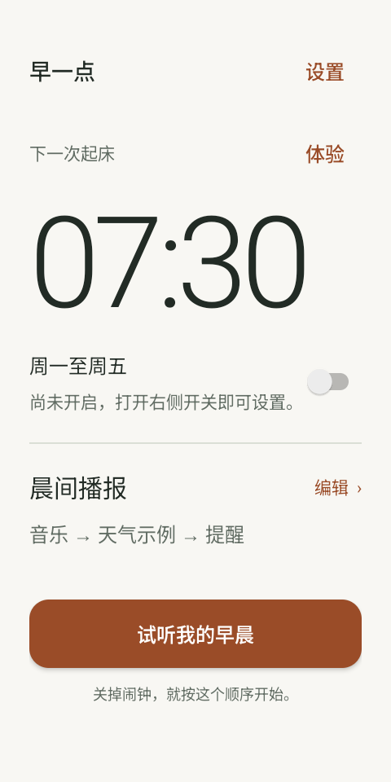
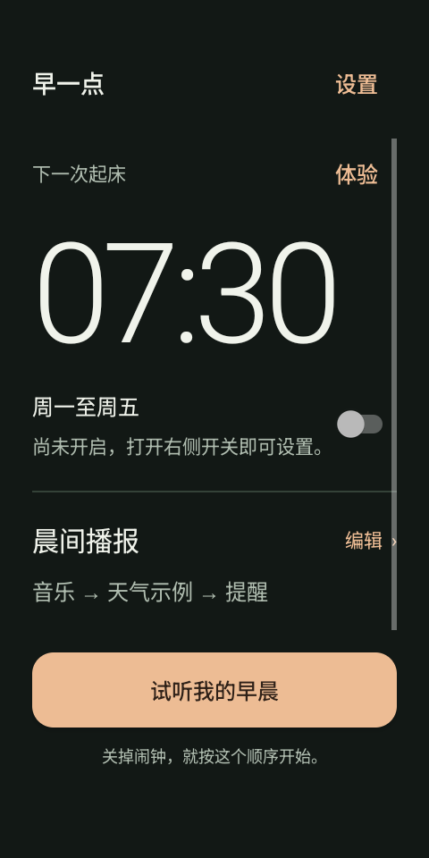
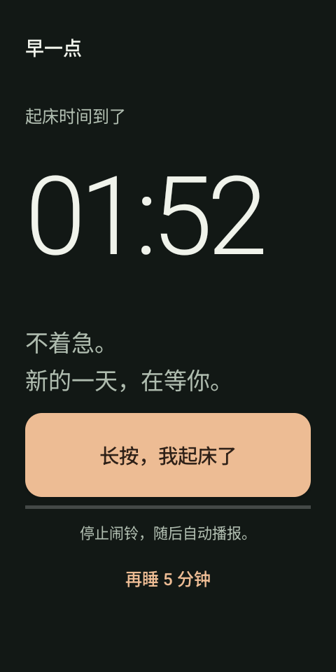
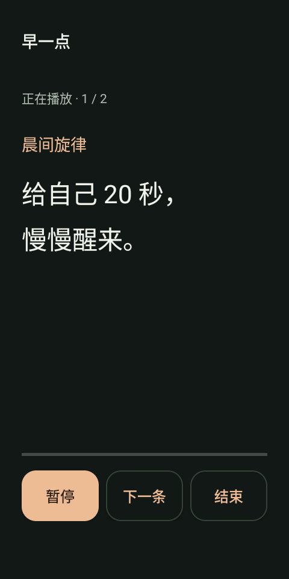
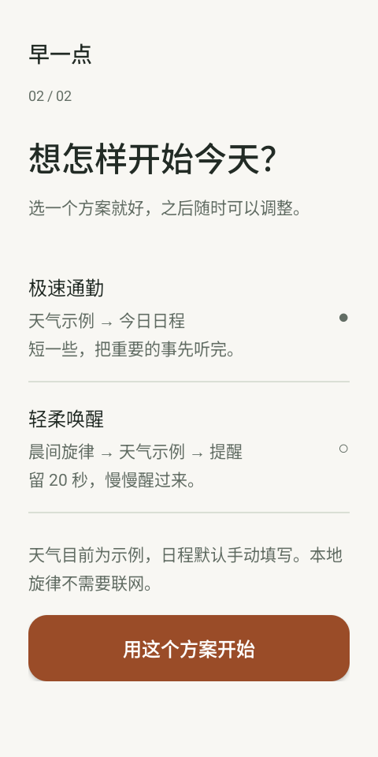
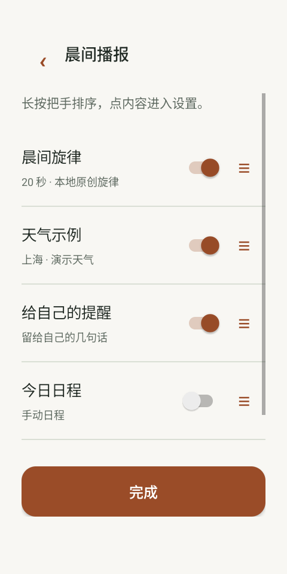

# 早一点 0.2.0 · 原生界面

以下图片来自 Android 15 模拟器上的应用窗口，通过 Android PixelCopy 截取实际原生控件与状态，不是网页设计稿。窗口图不包含系统状态栏、系统通知遮罩或导航栏。

设备视口 480×960px / 320×640dp。默认字体与 130% 字体分别验证；实际手机的系统字体和显示密度会有所不同。

| 日间首页 | 夜间首页 |
| --- | --- |
|  |  |

| 响铃：长按起床 | 播放器：暂停、下一条、结束 |
| --- | --- |
|  |  |

| 首次方案选择 | 播报顺序 |
| --- | --- |
|  |  |

更多：[起床时间](onboarding-time.png) · [130% 字体](large-font.png) · [拖拽后的顺序](drag-order.png) · [暂停态](player-paused.png) · [未授权跳过](skipped-item.png)

大字体在短屏上允许滚动，底部主动作保持可见；没有把内容缩成难读的小字以强行塞满一屏。
