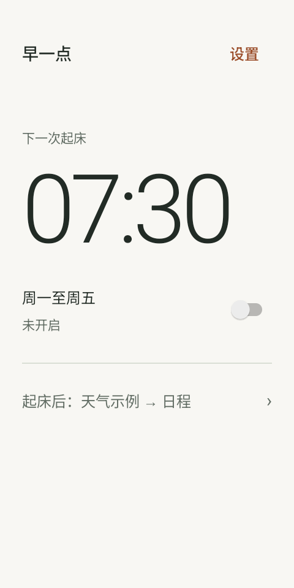
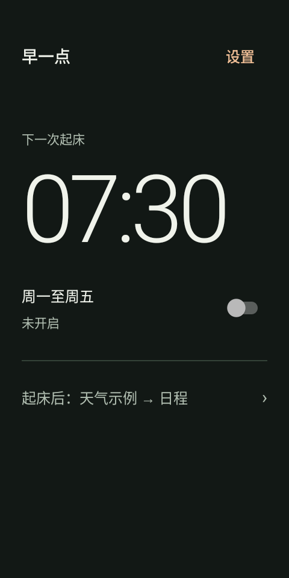

# 0.2.1 · 极简首页

Android 15 模拟器应用窗口实截（PixelCopy），不是网页设计稿。首页只保留大时间、重复星期、开关及一行播报摘要；右上角仅有设置。

| 日间 | 夜间 |
| --- | --- |
|  |  |

- [130% 字体首页](home-large-font.png)
- [试听已移到播报编辑页](broadcast-editor.png)
- [响铃测试已移到设置子页](alarm-test-settings.png)

截图视口为 480×960px / 320×640dp，不包含系统状态栏及导航栏。
