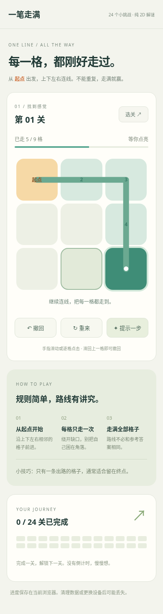

# 一笔走满

纯 2D 路线解谜小游戏。用一条不能重复的连续路线走满所有格子，提供 24 个逐步增加尺寸的关卡。房间装饰原型不再作为本游戏的开发方向。

## 下载与运行

[下载 ZIP 0.1.0](https://raw.githubusercontent.com/cxq24/xiaohongshu-tools/main/one-stroke/one-stroke-0.1.0.zip)

解压后打开根目录 `index.html`，无需联网或安装依赖。也可在本目录运行 `python3 -m http.server 8000 --directory build`，本机访问 `http://localhost:8000`。

## 怎么玩

- 从标记起点的格子出发，只能上下左右移动，不能跳格或走对角线。
- 手指滑动、鼠标拖动或逐格点击都可走格。滑回上一格或点撤回可退一步。
- 走满全部可见格子即可过关，不要求路线与参考答案一致。
- 每关过关后解锁下一关，可在选关中重玩已解锁关卡。
- 不用提示得三星，用一次提示得两星，两次及以上得一星。重玩保留历史最高星级。
- 提示沿参考路线走出一步；如果当前路线偏离参考路线，会回退到共同部分再走一步。提示不是对其他有效路线的否定。
- 进度保存在当前浏览器 localStorage，无账号、跨设备同步或后端。存储不可用时仍可在当前页面游玩；退出或清理数据可能丢失进度。
- 键盘：Tab 聚焦棋盘格后，可用方向键沿路线移动，Enter 或空格激活格子。

## 文件

- `build/index.html`、`style.css`、`game.js`、`levels.js`：全部运行文件。
- `one-stroke-0.1.0.zip`：只包含上述运行文件，`index.html` 位于根目录。
- `previews/`：电脑、手机布局与过关效果图，仅保留在仓库，不进入上传包。
- `package.py`：在任意目录执行即可重打包。拒绝上传截图白名单以外的文件类型。
- `DESIGN.md`：玩法与关卡设计说明。
- `VALIDATION.md`：实际验证记录与限制。

## 平台范围

本包是浏览器小游戏原型，未接入小红书或 TapTap SDK。按照此前部署截图的文件扩展名限制打包，不把 Markdown 文档打进 ZIP。尚未读取到被联网策略拦截的官方小红书 skill，也未在小红书宿主或 TapTap 中验证部署、触摸和进度持久化，不能据此认定已满足平台全部要求。

